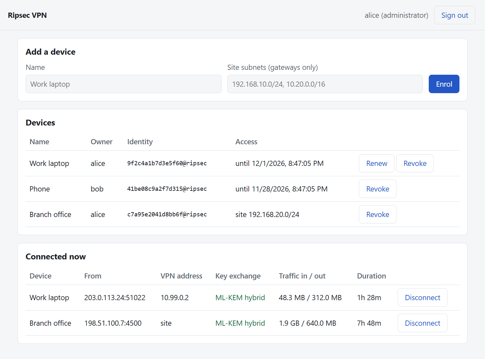
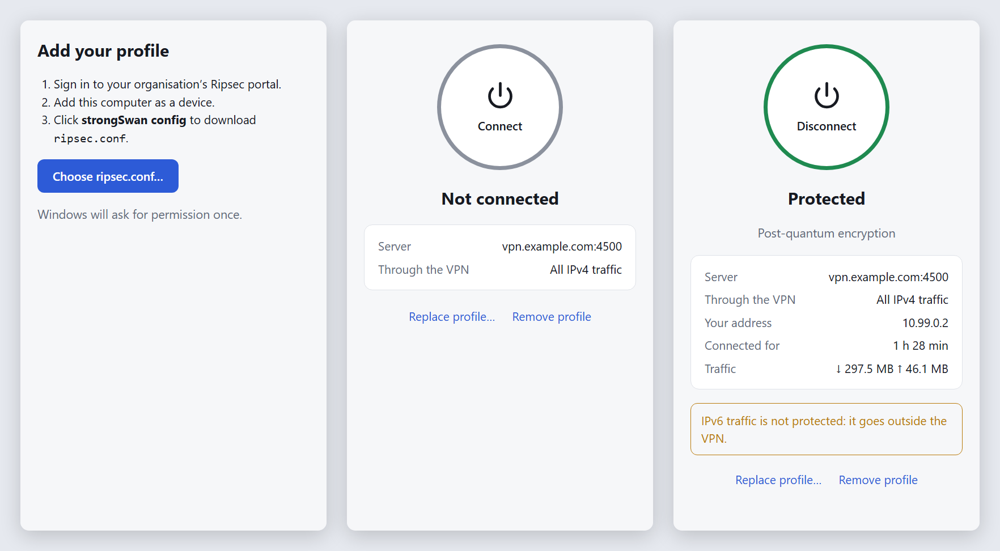
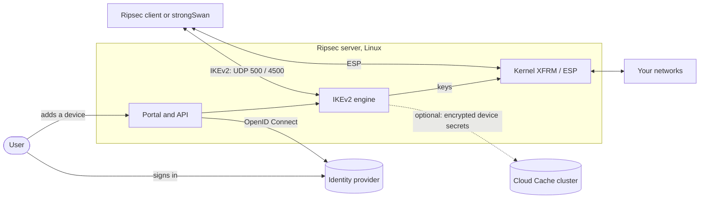

# Ripsec

**A post-quantum IKEv2/IPsec VPN, written in Rust, where people sign in with your identity provider.**

[](LICENSE)


> **Experimental.** Ripsec has not had a security audit. Try it, test it, break it, but do not rely on it to
> protect production or sensitive traffic yet.



## What it does

- **Post-quantum key exchange.** Every connection combines a classical exchange with ML-KEM (RFC 9370), so an
  attacker has to break both. Peers that cannot do this are refused by default.
- **Self-service with your identity provider.** Users sign in through OpenID Connect, add a device and download
  its profile. Credentials expire, can be renewed, and revoking one disconnects it within about a second.
- **Fast data path.** On the server, ESP packets are encrypted by the Linux kernel and never pass through
  user space.
- **Apps for Windows and Android and a command line client**, plus interoperability with strongSwan for road
  warriors and site-to-site gateways.
- **Secrets encrypted at rest**, on the server's disk or in a replicated
  [Cloud Cache](https://github.com/PlutoPro/Cloud-Cache) cluster.



<sub>Screenshots show the real interface with invented sample data.</sub>

## How it fits together



IKEv2 cannot speak OpenID Connect, so the portal bridges the two: a signed-in user receives a random 256 bit
secret for each device, and the device authenticates with it.

## Try it in five minutes

You need Docker (Linux, or Docker Desktop on Windows or macOS).

```sh
git clone https://github.com/PlutoPro/Ripsec.git
cd Ripsec/deploy
cp .env.example .env        # set KEYCLOAK_ADMIN_PASSWORD
docker compose up --build
```

Open <http://localhost:8480> and sign in as `alice` (administrator) or `bob` (user). The initial password is
`change-me`, and you choose a new one at first sign-in. Add a device and download its **strongSwan config**.

This stack is for evaluation only: it comes with its own Keycloak in development mode, demo users, and web
ports bound to this machine. See [Server setup](docs/server.md) for a real deployment.

## Connect a device

| Device | How | State |
|---|---|---|
| Windows 10 / 11 | [Ripsec app](docs/clients.md#windows-app) | New. The tunnel has been tried by hand; see the guide |
| Linux | [`ripsec-client`](docs/clients.md#command-line-client) | Tested against the server |
| Linux, routers (road warrior or site-to-site) | [strongSwan 6](docs/clients.md#strongswan) with ML-KEM | Tested (6.1.0) |
| iPhone, iPad, Mac (version 26 or later) | [Built-in VPN profile](docs/clients.md#apple-devices) | Profile generated, **never tested on a device** |
| Android 7.0 or later | [Ripsec app](docs/clients.md#android) | New. Tested on an emulator, **not on a phone** |
| Windows built-in VPN | | Not possible: it cannot sign in with a shared key |

## Documentation

| Guide | What is in it |
|---|---|
| [Server setup](docs/server.md) | Requirements, installation, every setting, operations, troubleshooting |
| [Identity providers](docs/identity-providers.md) | Keycloak step by step; Authentik, Okta, Entra ID, Auth0 and others |
| [Cloud Cache](docs/cloud-cache.md) | Keeping device secrets in a replicated cluster |
| [Clients](docs/clients.md) | Windows app, command line client, strongSwan, Apple devices |

## Security and limitations

What protects what:

| | |
|---|---|
| Key exchange | X25519, P-384 or P-256 **plus** ML-KEM-768 or ML-KEM-1024 |
| Encryption | AES-GCM, with 64 bit sequence numbers |
| Authentication | 256 bit random shared secrets, per device. There are no certificates |
| Secrets at rest | AES-256-GCM, bound to the device ID, with a master key that stays on the VPN server |
| Cryptography library | [AWS-LC](https://github.com/aws/aws-lc-rs) |

Know these before depending on it:

- **IPv4 only.** IPv6 traffic on a client is not carried and goes outside the VPN.
- AES-GCM only: no ChaCha20-Poly1305, CBC or MODP groups.
- The server answers rekeys but does not start them. The Ripsec client reconnects every eight hours instead.
- The Ripsec client has its own user-space ESP implementation, which is the newest security-critical code.
- Disabling a user at the identity provider does not cut their VPN until the credential expires or an
  administrator revokes the device.
- One live connection per device credential. No MOBIKE.
- No kill switch: if the VPN drops, traffic uses the normal network until it is back.
- One server only: there is no high availability yet.
- Throughput has not been measured.

## Development

```
crates/proto/   IKEv2 wire format, negotiation and cryptography, shared by both ends
src/            server: IKEv2 engine, kernel dataplane, portal, secret storage
client/         client library, command line client and Windows service
app/            Windows and Android app (Tauri)
deploy/         Docker images, compose stacks, example configuration
tests/          interoperability and end to end tests
```

```sh
cargo test --workspace                       # unit tests (the server builds on Linux only)
bash tests/interop/run.sh                    # strongSwan against the server, real kernel ESP
bash tests/client/run.sh                     # ripsec-client against the server
python tests/e2e/portal.py                   # Keycloak sign-in, enrolment, tunnel, revocation
python tests/cloudcache/run.py <cloud-cache> # against a three node Cloud Cache cluster
./scripts/build-windows.ps1 -Wintun <dll>    # Windows installer
./scripts/build-android.ps1                  # Android APK (debug)
```

The four tests after the first need Docker with a Linux kernel that supports IPsec.

## License

[MIT](LICENSE). The Windows installer bundles [Wintun](https://www.wintun.net), which has its own license.
