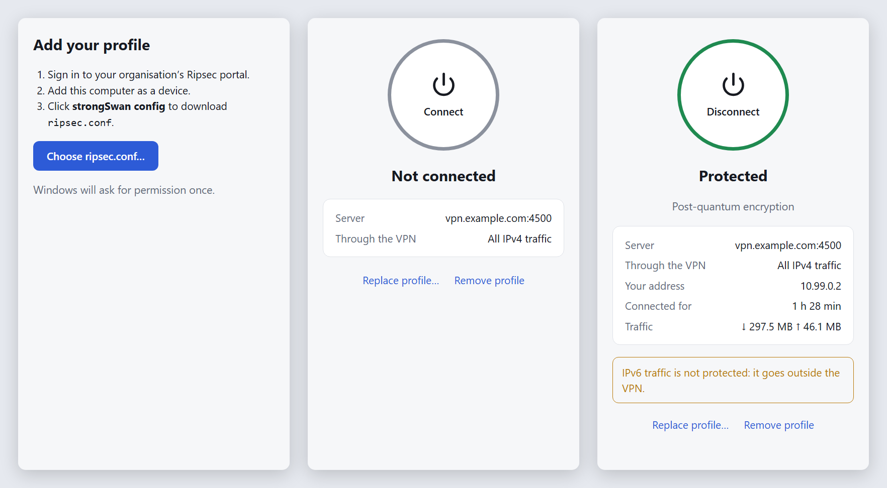

# Clients

[← README](../README.md)

- [Get a profile](#get-a-profile)
- [Windows app](#windows-app)
- [Command line client](#command-line-client)
- [strongSwan](#strongswan)
- [Apple devices](#apple-devices)
- [Android](#android)

## Get a profile

Sign in to the portal, name the device and click **Enrol**. Under "Save this now", download:

- **strongSwan config** (`ripsec.conf`) for the Ripsec app, `ripsec-client` and strongSwan;
- **iPhone / Mac profile** for Apple devices.

The secret is shown **once**. Treat the file like a password, and delete copies you do not need. Credentials
expire (seven days by default): renew the device in the portal; the profile stays the same.

## Windows app



Windows 10 or 11, 64 bit.

### Install

Run `Ripsec_<version>_x64-setup.exe` and approve the administrator prompt. Install to the default folder under
Program Files: the installer registers a service, which refuses to run from a folder ordinary users can change.

The installer is **not code signed**, so Windows SmartScreen will warn about it. Only run one you built
yourself or whose origin you trust.

### Use

1. Open **Ripsec** and click **Choose ripsec.conf…**.
2. Check the server and port, then **Add profile** and approve the prompt.
3. Click the round button to connect.

Closing the window keeps Ripsec in the notification area; the icon is green when connected. **Quit** closes
the app but leaves the VPN as it is, because the connection belongs to the service.

| Setting when adding a profile | When to change it |
|---|---|
| Server | The profile names an address this computer cannot use |
| Port | The server's port for NAT traversal is not 4500 |
| Only send these networks through the VPN | You want a split tunnel, for example `10.20.0.0/16` |

**Testing against a server on the same computer** (for example the Docker stack): use server `127.0.0.1`,
port `14500`, and limit the networks. A full tunnel would send the server's own traffic back into itself, so
the app refuses it.

### How it is put together

| Part | Runs as | Does |
|---|---|---|
| Ripsec app | you | Shows the state, asks the service to connect or disconnect |
| `RipsecVpn` service | the system | Owns the tunnel, the routes and the stored profile |

- Connecting and disconnecting need no special rights. **Any user signed in at this computer can do both.**
- Adding or removing a profile needs administrator approval, because a profile decides where traffic goes.
- The app and service talk over a local named pipe that never carries secrets. Other computers cannot reach it.
- The profile is stored in `C:\Program Files\Ripsec\data`, readable only by administrators and the system.
  A short log, `service.log`, is next to it.

### Current state

The service and its pipe are tested without administrator rights, and the underlying tunnel has been tried on
Windows by hand with a single routed address. The installer, the installed service, a full tunnel and the DNS
change have **not** been through systematic testing. There is no kill switch, no start-with-Windows option for
the app, and IPv6 is not carried.

### Troubleshooting

| Message | What to do |
|---|---|
| Service not running | Reinstall, or start "Ripsec VPN" in Windows Services |
| The server rejected this device | Revoked or expired. Renew or add the device again in the portal |
| No response from the server | Check server and port; UDP must be allowed on the way |
| The server is on this computer… | Limit the networks sent through the VPN |
| wintun.dll is missing | Reinstall |

### Uninstall

*Settings → Apps → Ripsec → Uninstall.* This removes the service and the stored profile.

### Build the installer

Needs Rust (MSVC toolchain), Node.js, and `wintun.dll` (`bin\amd64`) from <https://www.wintun.net>.

```powershell
./scripts/build-windows.ps1 -Wintun C:\path\to\wintun\bin\amd64\wintun.dll
```

The script checks the library's signature, builds the service and app, and writes the installer to
`app\target\release\bundle\nsis\`.

## Command line client

For Linux and Windows.

```sh
cargo build --release -p ripsec-client
ripsec-client check ripsec.conf       # handshake only; changes nothing, no special rights
sudo ripsec-client connect ripsec.conf
```

| Option | Meaning |
|---|---|
| `--server HOST` | Connect somewhere other than the profile says |
| `--port PORT` | Server's NAT traversal port (default 4500) |
| `--route CIDR` | Send only this network through the tunnel; repeat for more |

Ctrl+C disconnects and removes the routes. It reconnects by itself if the server stops answering or restarts. A
revoked device is refused on reconnecting, and it stops with that reason. It also stops if it keeps being closed
right after connecting, which happens when two machines share one profile.

- On Linux it creates `ripsec0` and needs root. DNS is set through `resolvectl` when present.
- On Windows, put `wintun.dll` next to the program and use an administrator prompt.
- It always carries ESP in UDP, so it works through NAT and on any port.
- Site-to-site profiles are for strongSwan; the client refuses them.

## strongSwan

Version 6.0 or later, built with ML-KEM support (through the `ml` plugin, or OpenSSL 3.5 or later).

```sh
sudo cp ripsec.conf /etc/swanctl/conf.d/
sudo swanctl --load-all
sudo swanctl --initiate --child net
```

**Site-to-site:** an administrator enrols a device with the branch's subnets, and the downloaded configuration
goes on the branch gateway. It connects by itself and reconnects.

## Apple devices

iOS, iPadOS and macOS **26 or later**, the first with post-quantum IKEv2. Download the **iPhone / Mac profile**,
open it on the device, install it in Settings, then turn the VPN on. Transfer it by AirDrop or a similar direct
route rather than email.

**This has never been tested on a real device.** Reports are welcome.

## Android

Android 7.0 or later. **New, and so far tested only on an Android 16 emulator, not on a phone.**

### Install

There is no published download yet. Build the APK and install it with USB debugging:

```powershell
./scripts/build-android.ps1                      # needs the Android SDK, an NDK, a JDK and Node.js
adb install app\gen\android\app\build\outputs\apk\universal\debug\app-universal-debug.apk
```

This is a **debug build**, signed with your local debug key: use it on your own devices, and do not distribute it.

### Use

1. Copy `ripsec.conf` to the phone (a cable or a similar direct route, not email).
2. Open **Ripsec**, tap **Choose ripsec.conf…**, check the server and port, then **Add profile**.
3. Tap the round button. The first time, Android asks you to allow the VPN, and may ask about notifications.
4. Delete the copy of `ripsec.conf` from your downloads.

The connection runs in the background with a notification, and survives leaving the app. Using another VPN app, or
turning this one off in Android's settings, disconnects it.

### How it behaves

- **IPv6 is blocked** while connected, so it cannot bypass the VPN.
- The profile is kept in the app's private storage, excluded from backups. It is not additionally encrypted.
- No always-on VPN and no start at boot yet. There is no kill switch while reconnecting.
- After switching networks (Wi-Fi to mobile data) expect about a minute before traffic resumes.
- If Android is very short of memory it may close the app while you are picking a file; pick it again.

### What was tested

On the emulator: adding a profile, the permission prompt, a full tunnel with traffic both ways, disconnecting,
reconnecting, running in the background for a short while, and recovering from a server restart. Large pings that
had to be fragmented lost about 2% of replies; full-size packets lost none. Not tested: a physical phone, network
switching, long sleeps and battery use.
